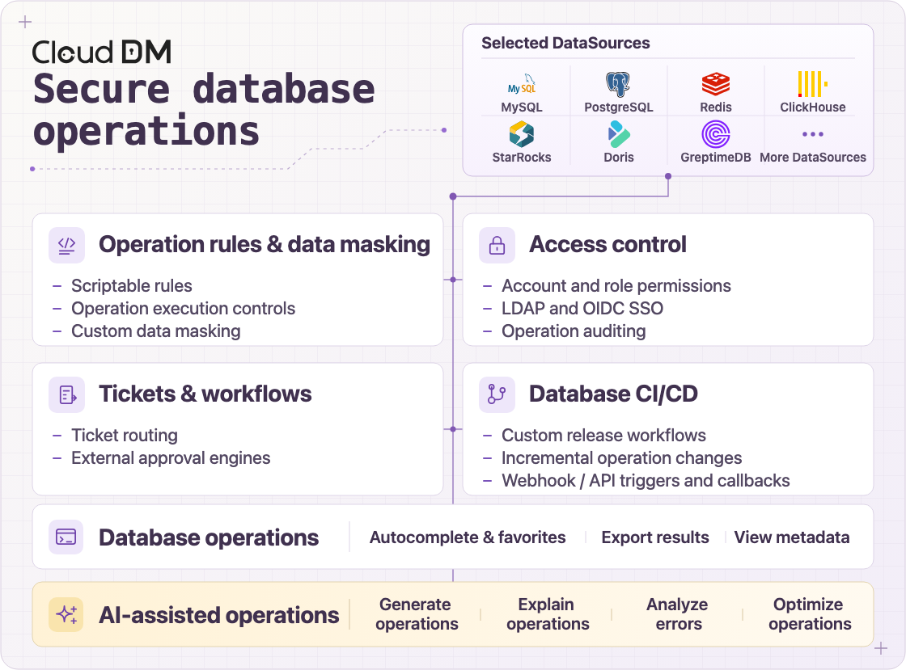
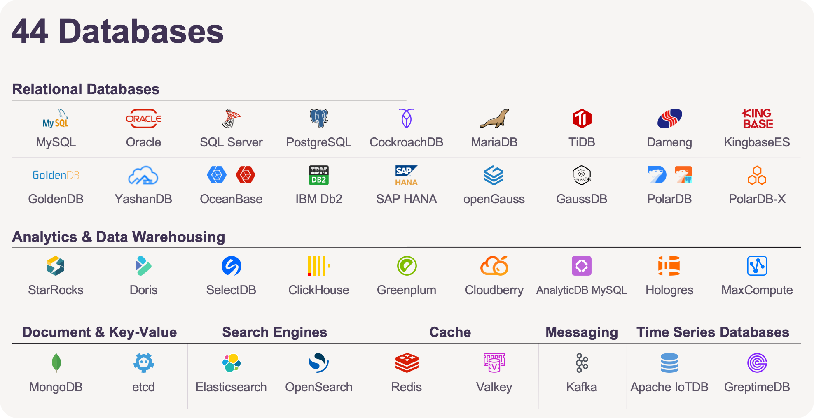
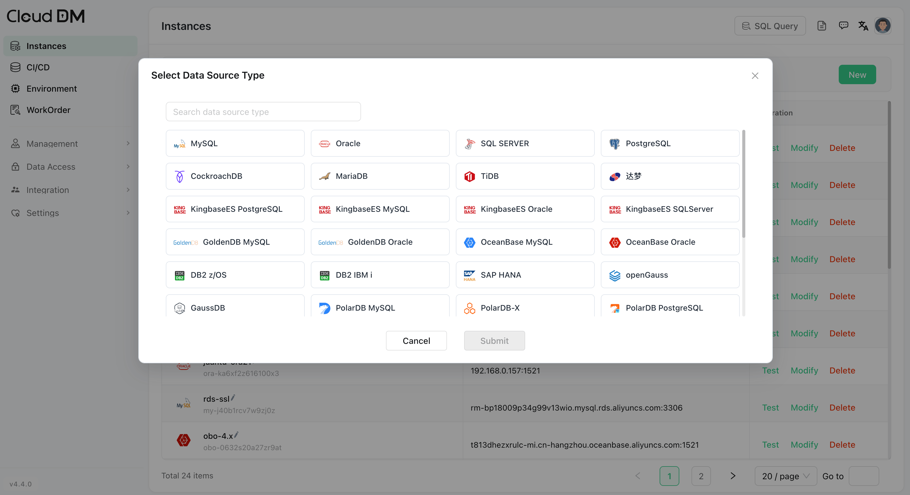
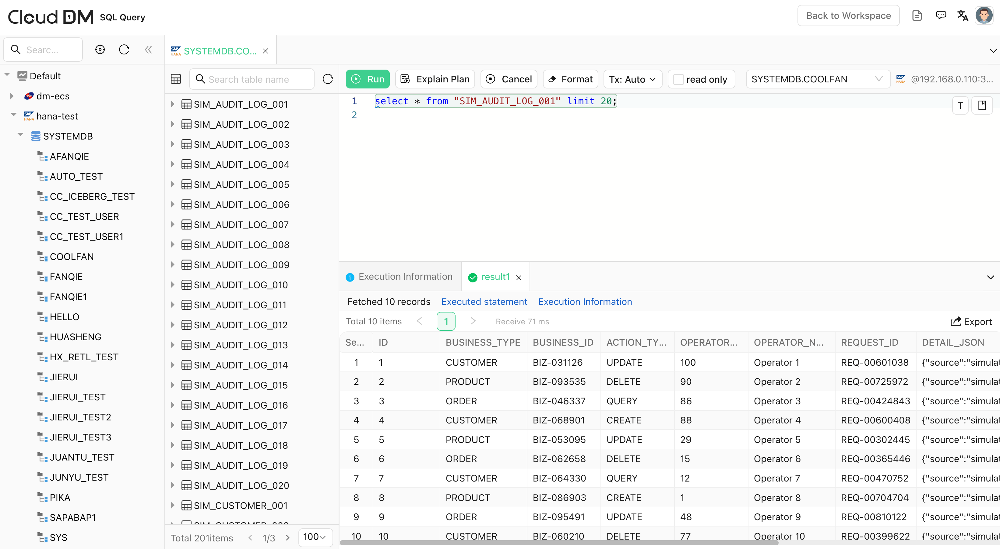

<h1 align="center">CloudDM</h1>

<p align="center">
  <a href="LICENSE.txt"></a>
  <a href="https://github.com/ClouGence/open-cdm/stargazers"></a>
</p>

<p align="center">
  <a href="https://trendshift.io/repositories/31757"></a>
  <a href="https://trendshift.io/repositories/31757"></a>
</p>

<p align="center">
  CloudDM is a free, open-source database management tool that helps teams query data, manage access, and roll out reviewed database changes from a single web console.
</p>

<p align="center">
  <a href="#quick-start"><b>Quick Start</b></a> •
	<a href="https://www.cdmgr.com/"><b>Home</b></a> •
	<a href="https://www.cdmgr.com/docs/intro/product_intro"><b>Docs</b></a> •
    <a href="https://www.cdmgr.com/blog"><b>Blog</b></a> •
  <a href="https://gitee.com/clougence/open-cdm"><b>Gitee</b></a> •
  <a href="https://github.com/ClouGence/open-cdm"><b>GitHub</b></a>
</p>

<p align="center">
    [<a target="_blank" href='docs/README.cn.md'>中文</a>]
    [<a target="_blank" href='docs/README.en.md'>English</a>]
</p>



---

## Project Facts

| Field | Value                                           |
|------|-------------------------------------------------|
| Project name | CloudDM                                         |
| Repository | https://github.com/ClouGence/open-cdm           |
| Mirror | https://gitee.com/clougence/open-cdm            |
| Homepage | https://www.cdmgr.com/                          |
| Documentation | https://www.cdmgr.com/docs/intro/product_intro  |
| License | Apache License 2.0                              |
| Current version | 4.8.0                                           |
| Main languages | Java, JavaScript / TypeScript                   |
| Deployment modes | Standalone (Alone), Cluster (Console + Sidecar) |
| Deployment targets | Install package, Docker, Kubernetes             |

## Core Capabilities

### Databases



### Operation Rules and Data Masking

- Check SQL before execution and use rules to warn about or block risky statements.
- Extend the built-in rules with scripts and apply custom masking to sensitive data.

### Access Control

- Use role-based access control (RBAC) to assign feature permissions and grant resource access at the instance, database, schema, or table level. Handle access requests and issue temporary grants.
- Integrate with OpenLDAP, Active Directory, or an OIDC provider for authentication. Review user activity in the audit log.

### Tickets and Workflows

- Use tickets to review SQL changes and access requests. Execute approved changes manually, immediately, or at a scheduled time.
- Use CloudDM's built-in approval engine or connect DingTalk, Feishu, or WeCom.

### Database CI/CD

- Configure release workflows and track incremental changes to database scripts.
- Trigger releases through Git push, a webhook, or the HTTP API, and send change results to external systems via callbacks.
- Use Gitee or [GitLab Self-Managed](docs/guides/gitlab-cicd.en.md) as the repository for database changes.

### Database Operations

- Run queries and transactions in a web console with syntax highlighting, autocomplete, and favorites. Inspect execution plans and export query results.
- Browse metadata and manage database objects such as tables and indexes.

### AI-Assisted Operations

Use the AI assistant to generate and explain SQL, analyze errors, and get optimization suggestions.

## Quick Start

### Install
CloudDM supports **Standalone (Alone)** and **Cluster (Console + Sidecar)** modes, and also supports **install packages**, **Docker**, and **Kubernetes** deployment methods.

The example below demonstrates how to use standalone deployment. If you need install-package deployment, cluster deployment, or Kubernetes deployment, you can continue deploying with the install packages and yml files generated after local packaging. For complete deployment instructions, see [deployment.en.md](docs/guides/deployment.en.md).

```bash
# Quick start, default image
docker run -d --name cgdm-alone \
  -p 8222:8222 \
  -v cgdm_alone_conf:/root/cgdm/alone/conf \
  -v cgdm_alone_logs:/root/cgdm/alone/logs \
  -v cgdm_alone_data:/root/cgdm/alone/data \
  -v cgdm_mysql_data:/var/lib/mysql \
  bladepipe/cgdm-alone:4.8.0

# Faster image pulls in China
docker run -d --name cgdm-alone \
  -p 8222:8222 \
  -v cgdm_alone_conf:/root/cgdm/alone/conf \
  -v cgdm_alone_logs:/root/cgdm/alone/logs \
  -v cgdm_alone_data:/root/cgdm/alone/data \
  -v cgdm_mysql_data:/var/lib/mysql \
  cloudcanal-registry.cn-shanghai.cr.aliyuncs.com/clougence/cgdm-alone:4.8.0
```

Host directory mount example:

```bash
mkdir -p /data/cgdm/{conf,logs,data,mysql}

docker run -d --name cgdm-alone \
  -p 8222:8222 \
  -v /data/cgdm/conf:/root/cgdm/alone/conf \
  -v /data/cgdm/logs:/root/cgdm/alone/logs \
  -v /data/cgdm/data:/root/cgdm/alone/data \
  -v /data/cgdm/mysql:/var/lib/mysql \
  bladepipe/cgdm-alone:4.8.0
```

When `/data/cgdm/conf` is empty, CloudDM initializes it with the default configuration files on startup.

### Offline Image Deployment

When the host cannot reach an image registry, download the architecture-specific archive `cgdm-alone-image-<arch>.tar.gz` from the [GitHub Release](https://github.com/ClouGence/open-cdm/releases), load it on the target host, and start it as shown above.

```bash
gunzip -c cgdm-alone-image-<arch>.tar.gz | docker load
```

This loads the image `bladepipe/cgdm-alone:<version>`. Then start it with the `docker run` commands shown above.

For cluster deployment, use `cgdm-cluster-image-<arch>.tar.gz`. It contains the versioned Console and Sidecar images together with `mysql:8.0`.

### Upgrade

Before upgrading, back up Docker volumes or database data. To upgrade, remove the old container and start the new image with the same volumes.

```bash
# Default image
docker rm -f cgdm-alone
docker pull bladepipe/cgdm-alone:4.8.0
docker run -d --name cgdm-alone \
  -p 8222:8222 \
  -v cgdm_alone_conf:/root/cgdm/alone/conf \
  -v cgdm_alone_logs:/root/cgdm/alone/logs \
  -v cgdm_alone_data:/root/cgdm/alone/data \
  -v cgdm_mysql_data:/var/lib/mysql \
  bladepipe/cgdm-alone:4.8.0

# China acceleration image
docker rm -f cgdm-alone
docker pull cloudcanal-registry.cn-shanghai.cr.aliyuncs.com/clougence/cgdm-alone:4.8.0
docker run -d --name cgdm-alone \
  -p 8222:8222 \
  -v cgdm_alone_conf:/root/cgdm/alone/conf \
  -v cgdm_alone_logs:/root/cgdm/alone/logs \
  -v cgdm_alone_data:/root/cgdm/alone/data \
  -v cgdm_mysql_data:/var/lib/mysql \
  cloudcanal-registry.cn-shanghai.cr.aliyuncs.com/clougence/cgdm-alone:4.8.0
```

### Initialization

Access the product in your browser:

```
http://localhost:8222
```

> On first access after a fresh deployment, the initialization wizard will open; during an upgrade, the upgrade wizard will open.
>
> The default account is **admin@cdmgr.com**.

### Add Data Source



### Query Data



## Open Source License

CloudDM is released under the business-friendly [Apache License 2.0](https://www.apache.org/licenses/LICENSE-2.0.html). See [LICENSE.txt](./LICENSE.txt) for details.
