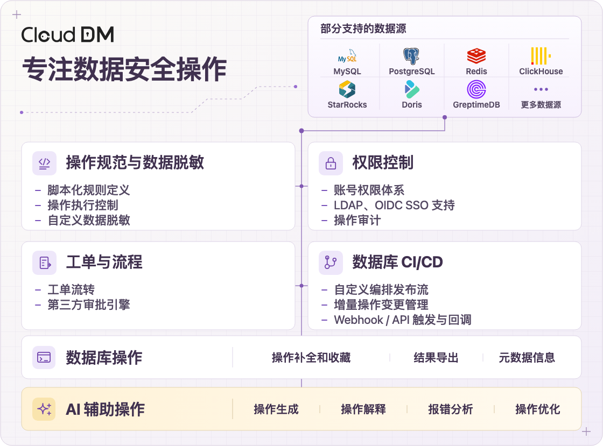
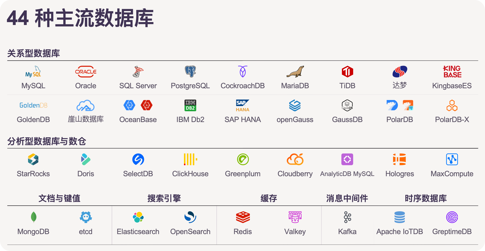
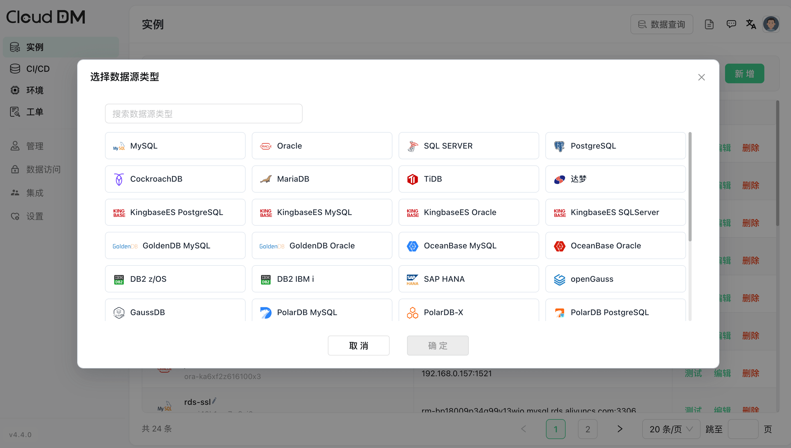
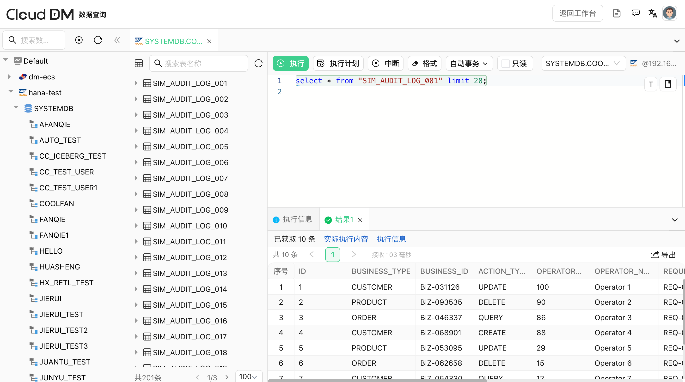

<h1 align="center">CloudDM</h1>

<p align="center">
  <a href="../LICENSE.txt"></a>
  <a href="https://github.com/ClouGence/open-cdm/stargazers"></a>
</p>

<p align="center">
  <a href="https://trendshift.io/repositories/31757"></a>
  <a href="https://trendshift.io/repositories/31757"></a>
</p>

<p align="center">
  CloudDM 是面向团队的免费开源数据库管理工具。团队可通过统一的 Web 控制台查询数据、管理访问权限，并审核和发布数据库变更。
</p>

<p align="center">
  <a href="#快速开始"><b>快速开始</b></a> •
	<a href="https://www.cdmgr.com/"><b>首页</b></a> •
	<a href="https://www.cdmgr.com/docs/intro/product_intro"><b>文档</b></a> •
    <a href="https://www.cdmgr.com/blog"><b>Blog</b></a> •
  <a href="https://gitee.com/clougence/open-cdm"><b>Gitee</b></a> •
  <a href="https://github.com/ClouGence/open-cdm"><b>GitHub</b></a>
</p>

<p align="center">
    [<a target="_blank" href='./README.cn.md'>中文</a>]
    [<a target="_blank" href='./README.en.md'>English</a>]
    [<a target="_blank" href='reference/faq.cn.md'>FAQ</a>]
</p>



---

## 项目信息

| 字段   | 内容                                             |
|------|------------------------------------------------|
| 项目名称 | CloudDM                                        |
| 代码仓库 | https://github.com/ClouGence/open-cdm          |
| 国内镜像 | https://gitee.com/clougence/open-cdm           |
| 官网   | https://www.cdmgr.com/                         |
| 文档   | https://www.cdmgr.com/docs/intro/product_intro |
| 开源协议 | Apache License 2.0                             |
| 当前版本 | 4.8.0                                          |
| 主要语言 | Java、JavaScript / TypeScript                   |
| 部署模式 | 单机模式（Alone）、集群模式（Console + Sidecar）            |
| 部署方式 | 安装包、Docker、Kubernetes                          |

## 核心能力

### 数据库



### 操作规范与数据脱敏

- 在执行 SQL 前检查风险，按规则发出警告或阻止执行。
- 使用脚本扩展内置规则，并按需对敏感数据进行自定义脱敏。

### 权限控制

- 通过基于角色的访问控制（RBAC）分配功能权限，按实例、数据库、Schema 或表授予资源权限。支持权限申请和临时授权。
- 支持 OpenLDAP、Active Directory 和 OIDC 等身份认证方式，可在操作审计中查看操作记录。

### 工单与流程

- 通过工单审核 SQL 变更和权限申请。审批通过后可手动、立即或定时执行变更。
- 可使用内置审批引擎，也可对接钉钉、飞书或企业微信。

### 数据库 CI/CD

- 自定义发布流程，跟踪数据库脚本的增量变更。
- 通过 Git Push、Webhook 或 HTTP API 触发发布，并将变更结果回调给外部系统。
- 支持使用 Gitee 或 [GitLab Self-Managed](guides/gitlab-cicd.cn.md) 管理数据库变更。

### 数据库操作

- 在 Web 控制台执行查询和事务，支持语法高亮、自动补全和收藏，可查看执行计划并导出查询结果。
- 浏览元数据，并管理表、索引等数据库对象。

### AI 辅助操作

使用 AI 助手生成和解释 SQL、分析报错并获取优化建议。

## 快速开始

### 安装

CloudDM 支持 **单机模式（Alone）** 和 **集群模式（Console + Sidecar）**，同时支持 **安装包**、**Docker**、**Kubernetes**
多种部署方式。

下面以单机模式部署来展示如何使用。如果你需要安装包部署、集群部署或 Kubernetes 部署，可使用本地打包后生成的安装包和 yml
文件继续部署。完整部署说明请参考 [deployment.cn.md](guides/deployment.cn.md)。

```bash
# 快速启动，默认镜像
docker run -d --name cgdm-alone \
  -p 8222:8222 \
  -v cgdm_alone_conf:/root/cgdm/alone/conf \
  -v cgdm_alone_logs:/root/cgdm/alone/logs \
  -v cgdm_alone_data:/root/cgdm/alone/data \
  -v cgdm_mysql_data:/var/lib/mysql \
  bladepipe/cgdm-alone:4.8.0

# 中国地区，使用加速镜像
docker run -d --name cgdm-alone \
  -p 8222:8222 \
  -v cgdm_alone_conf:/root/cgdm/alone/conf \
  -v cgdm_alone_logs:/root/cgdm/alone/logs \
  -v cgdm_alone_data:/root/cgdm/alone/data \
  -v cgdm_mysql_data:/var/lib/mysql \
  cloudcanal-registry.cn-shanghai.cr.aliyuncs.com/clougence/cgdm-alone:4.8.0
```

本地目录挂载示例：

```bash
mkdir -p /data/cgdm/{conf,logs,data,mysql}

docker run -d --name cgdm-alone \
  -p 8222:8222 \
  -v /data/cgdm/conf:/root/cgdm/alone/conf \
  -v /data/cgdm/logs:/root/cgdm/alone/logs \
  -v /data/cgdm/data:/root/cgdm/alone/data \
  -v /data/cgdm/mysql:/var/lib/mysql \
  bladepipe/cgdm-alone:4.8.0
```

当 `/data/cgdm/conf` 是空目录时，CloudDM 会在启动时自动写入默认配置文件。

### 离线镜像部署

内网无法访问镜像仓库时，可从 [GitHub Release](https://github.com/ClouGence/open-cdm/releases) 下载对应架构的镜像归档
`cgdm-alone-image-<arch>.tar.gz`，在目标主机加载后按上述方式启动。

```bash
gunzip -c cgdm-alone-image-<arch>.tar.gz | docker load
```

加载得到镜像 `bladepipe/cgdm-alone:<version>`，随后使用该镜像按上文的 `docker run` 启动即可。

集群部署请使用 `cgdm-cluster-image-<arch>.tar.gz`，其中包含对应版本的 Console、Sidecar 镜像以及 `mysql:8.0`。

### 升级

升级前建议先备份 Docker 卷或数据库数据。升级时删除旧容器并使用相同卷启动新版本镜像即可保留已有数据。

```bash
# 默认镜像
docker rm -f cgdm-alone
docker pull bladepipe/cgdm-alone:4.8.0
docker run -d --name cgdm-alone \
  -p 8222:8222 \
  -v cgdm_alone_conf:/root/cgdm/alone/conf \
  -v cgdm_alone_logs:/root/cgdm/alone/logs \
  -v cgdm_alone_data:/root/cgdm/alone/data \
  -v cgdm_mysql_data:/var/lib/mysql \
  bladepipe/cgdm-alone:4.8.0

# 中国区加速镜像
docker rm -f cgdm-alone
docker pull cloudcanal-registry.cn-shanghai.cr.aliyuncs.com/clougence/cgdm-alone:4.8.0
docker run -d --name cgdm-alone \
  -p 8222:8222 \
  -v cgdm_alone_conf:/root/cgdm/alone/conf \
  -v cgdm_alone_logs:/root/cgdm/alone/logs \
  -v cgdm_alone_data:/root/cgdm/alone/data \
  -v cgdm_mysql_data:/var/lib/mysql \
  cloudcanal-registry.cn-shanghai.cr.aliyuncs.com/clougence/cgdm-alone:4.8.0
```

### 初始化

通过浏览器访问产品

```
http://localhost:8222
```

> 首次部署访问会进入初始化向导；升级时会进入升级向导。
>
> 如果你并未修改过账号，则默认为 **admin@cdmgr.com**

### 添加数据源



### 数据查询



## 开源协议

CloudDM 使用商业友好的 [Apache License 2.0](https://www.apache.org/licenses/LICENSE-2.0.html)
许可协议，详见 [LICENSE.txt](../LICENSE.txt)。
